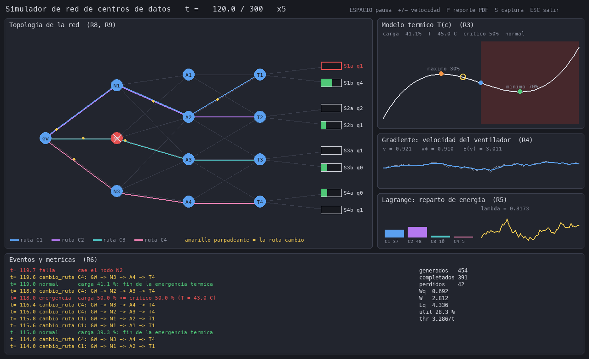

# Simulador de optimización de una red de centros de datos

**Autores:** Victor Linarez - Claudia Medina
**Universidad José Antonio Páez — Ingeniería en Computación — Métodos Cuantitativos (octubre 2026)**

Simulador orientado a objetos de una red de centros de datos que integra programación dinámica,
optimización no lineal y simulación de eventos discretos, con un dashboard en Pygame y un reporte PDF.



## Módulos

| Módulo | Contenido | Código |
|--------|-----------|--------|
| M1 — Programación dinámica | Ruta más corta por etapas y mochila 0/1 | `src/core/programacion_dinamica/` |
| M2 — No lineal | Modelo térmico, descenso por gradiente, Lagrange | `src/core/no_lineal/` |
| M3 — Simulación | SimPy, dashboard Pygame, reporte PDF con Gemini | `src/simulation/`, `src/gui/`, `src/services/` |

## Instalación

```bash
python3.11 -m venv venvProyecto
source venvProyecto/bin/activate
pip install -r requirements.txt
cp .env.example .env   # opcional: poner GEMINI_API_KEY para el análisis con IA
```

Sin clave de Gemini el PDF se genera igual, sin la sección de IA.

## Uso

```bash
python main.py                         # dashboard en vivo
python main.py --headless --reporte    # simulación sin ventana + PDF en outputs/
python main.py --modulo m1             # solo programación dinámica
python main.py --modulo m2             # solo optimización no lineal
```

Teclas del dashboard: `ESPACIO` pausa, `+`/`-` velocidad, `P` reporte PDF, `S` captura, `ESC` salir.
Los datos de entrada están en `data/escenario_default.json` (se puede usar otro con `--escenario`).

## Resumen de los modelos

- **Ruta más corta:** recursión hacia atrás sobre las etapas gateway → núcleo → agregación → ToR;
  el costo de cada enlace crece con la congestión (M/M/1). Resultado base: `GW → N1 → A2 → T1`, costo 7.
- **Mochila 0/1:** cada servidor elige qué paquetes atender según su capacidad libre
  (C1: P2, P4, P6, P7 → valor 30).
- **Modelo térmico:** `T(c) = 0.0002c³ − 0.03c² + 1.26c + 30`; máximo local en 30 %, mínimo en 70 %,
  punto crítico (inflexión) en 50 %.
- **Gradiente:** ajusta la velocidad del ventilador minimizando `E(v) = a·v³ + b·Q/v` (óptimo v* = 1 con Q = 60).
- **Lagrange:** reparte la energía entre clústeres maximizando `Σ wᵢ ln(1+Eᵢ)`, con corrección KKT si algún `Eᵢ < 0`.
- **Simulación:** llegadas Poisson, servicio exponencial y fallas/reparaciones de nodos; en la corrida
  de referencia (semilla 42, 300 u.t.) se completan 1115 de 1225 paquetes.

Más detalle en `PLAN.md` (diseño y clases) y `RESULTADOS.md` (resultados completos).

## Pruebas

```bash
python -m pytest -q
```
